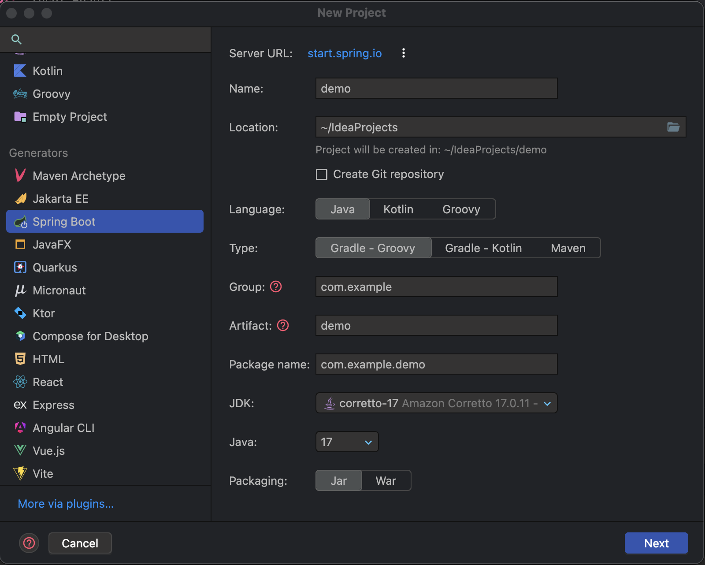
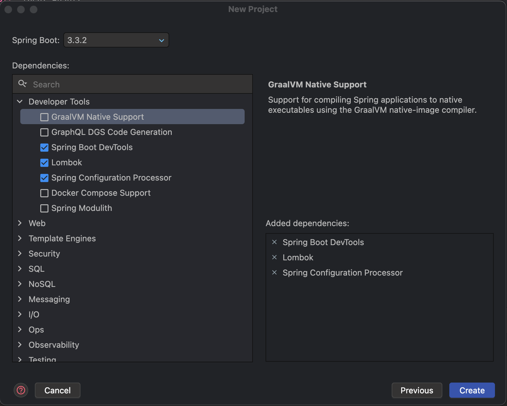
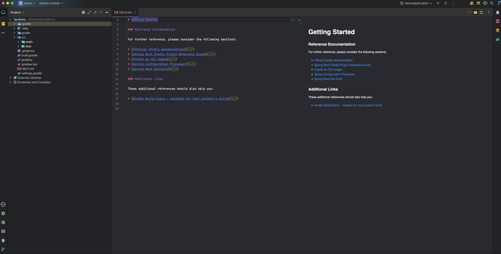

IntelliJ에서 SpringBoot 프로젝트를 생성하는 방법에 대해 포스팅하려고 한다.

우선,

시작 화면에서 "New Project"를 클릭 혹은

메뉴바에서 File -&gt; New -&gt; Project 순으로 클릭한다.   

그러면

*Project 생성 화면*

이런 화면이 나오는데 Spring Boot를 선택해 준다   
Name은 본인이 원하는 대로 작성   
Location도 다른 디렉토리에 저장하고 싶다면 변경해 주면 된다.   
아래에 Create Git repository를 클릭하면 Git 레포지토리도 생성할 수 있다.

JDK, Java 버젼 선택해 주고 패키징을 Jar, War 중에 선택해 주면 된다.

다음 화면으로 넘어가보자!!

*스프링부트 버전 및 의존성 추가 화면*

이 화면이 나올텐데 스프링부트 버전을 선택하고 의존성을 추가할 수 있다.

pom.xml(Maven) 또는 build.gradle(Gradle) 파일에서 의존성을 추가하거나 수정할 수 있으니   
너무 걱정하지 마시고 Create 버튼을 클릭하자.

*프로젝트 생성 완료!!*

프로젝트 생성이 완료되었다!!

