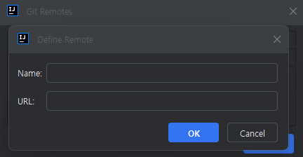
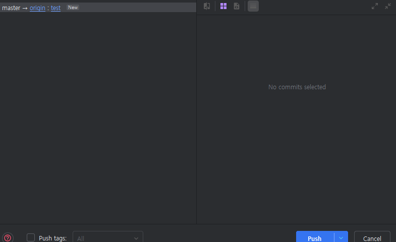

### **IntelliJ에서 GitHub연동 방법**

1. **GitHub Repository 생성**우선 GitHub 사이트에서 로그인 후 프로젝트에 사용할 레포지토리를 생성해준다. 생성되어 있던 것도 무관!!

*깃 허브 레포지토리 생성*

이미지의 New를 눌러서 생성해주면 된다!

    2. **IntelliJ GitHub 로그인**

IntelliJ 상단 메뉴바에서 VCS -&gt; Get from Version Control -&gt; GitHub -&gt; Log in via GitHub -&gt; Authorize in GitHub   
        순으로 진행한다.  

        만약 ID 비밀번호로 로그인이 안된다면 Git 토큰을 생성하여 토큰으로 로그인 해보자!

    3. **IntelliJ Git Repository 등록**        IntelliJ 상단 메뉴바에서 Git -&gt; Manage Reotes... -&gt; +버튼을 누르고 GitHub 레포지토리의 URL을 입력한다.

*IntelliJ Git Reomotes 추가 화면*

*GitHub URL 확인 방법*

위의 사진의 Code를 클릭하면 URL정보를 알 수 있다!!

    4. **Commit, Push 해보기**

        여기까지 되었다면 레포지토리 연결은 끝났고 현재 작업중인 프로젝트를 깃 레포지토리에 올려보자  
        Git -&gt; Commit 을 클릭하여 대상을 선택하고, 메세지 입력 후 커밋을 한다.

        이후 Commit 내역을 Push 해보자!!

*IntelliJ Push화면*

test를 new_test로 변경해서 푸쉬하면 GitHub에 'new_test'라는 원격브랜치가 생성되고

해당 브랜치에 Push된다.

현재 작업중인 프로젝트를 GitHub에 연동하고 싶은데 방법을 모르겠다면

오늘의 포스팅이 도움이 되길 바란다!!
